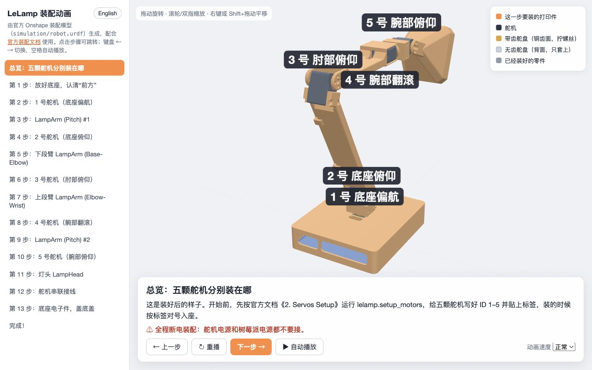
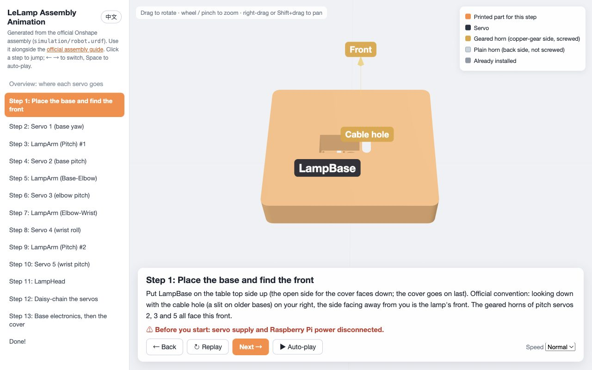
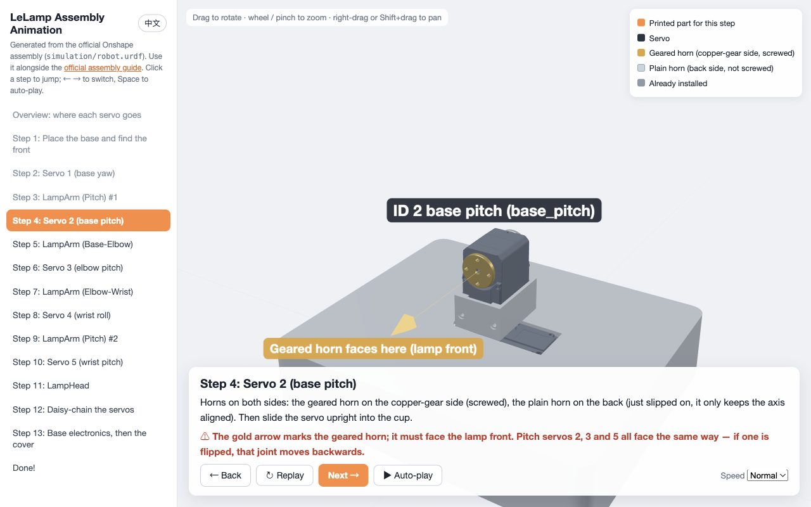
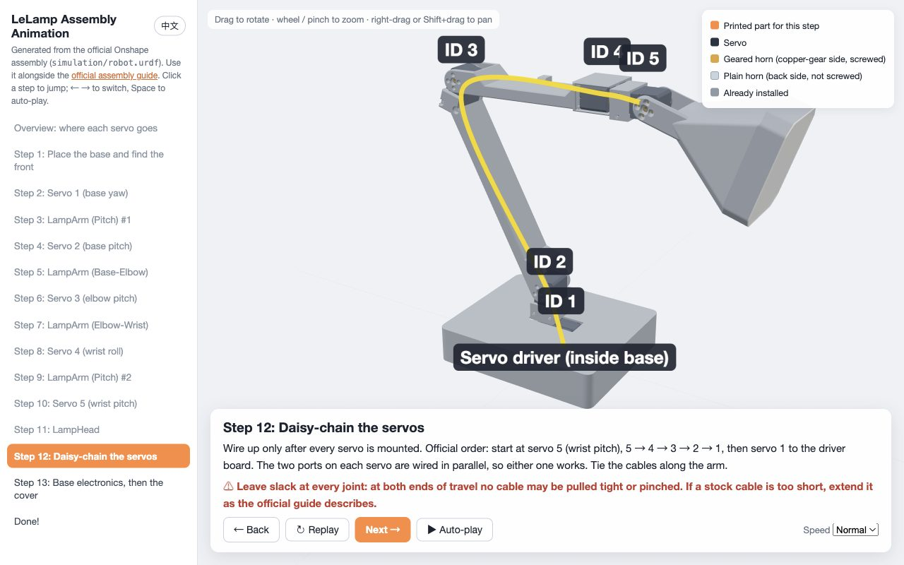

# LeLamp Assembly Animation / 装配动画

An interactive, step-by-step 3D animation of the LeLamp body assembly, in English and Chinese. It is generated from the official Onshape assembly ([`simulation/robot.urdf`](../../simulation/robot.urdf)), so every part sits exactly where the CAD puts it. Use it next to [3. LeLamp Assembly](../3.%20LeLamp%20Assembly.md).

一个可交互的 LeLamp 灯身分步装配 3D 动画，中英双语。模型直接由官方 Onshape 装配（[`simulation/robot.urdf`](../../simulation/robot.urdf)）生成，零件位置和 CAD 完全一致。请配合 [3. LeLamp Assembly](../3.%20LeLamp%20Assembly.md) 使用。



## Open it / 打开方式

- **Online / 在线：** [open in the browser](https://htmlpreview.github.io/?https://github.com/humancomputerlab/LeLamp/blob/master/docs/assembly_animation/LeLamp_Assembly_Animation.html) (via htmlpreview.github.io; the first load fetches ~3 MB).
- **Offline / 离线：** download [`LeLamp_Assembly_Animation.html`](./LeLamp_Assembly_Animation.html) and double-click it. It is a single self-contained file and needs no network. `?lang=en` or `?lang=zh` in the address picks the language.
  下载 `LeLamp_Assembly_Animation.html` 后双击打开即可，单文件、无需联网。

The language follows the browser and can be switched at any time with the 中文 / English button. Drag to rotate, scroll or pinch to zoom, right-drag or Shift+drag to pan, ← → to change steps, Space to auto-play.

Tested in Chromium (desktop and phone-sized viewports). It needs WebGL and `DecompressionStream`, i.e. Chrome/Edge 80+, Safari 16.4+ or Firefox 113+.

## What it covers / 内容

| | |
|---|---|
| Overview | Where servos ID 1–5 go (set IDs first with [2. Servos Setup](../2.%20Servos%20Setup.md)) |
| Step 1 | Base, and the official "front" convention (top-down, cable hole on the right → front is away from you) |
| Steps 2–11 | Each servo and printed part, in order. Geared horn and plain horn fly in separately; the gold arrow shows that the geared horn of every pitch servo (2, 3, 5) faces the front; yaw (1) and roll (4) get the geared horn only |
| Step 12 | Daisy-chain wiring, servo 5 → 4 → 3 → 2 → 1 → driver |
| Step 13 | Base electronics and cover |
| Done | Pointers to [4. LeLamp Setup](../4.%20LeLamp%20Setup.md) and calibration in [5. LeLamp Control](../5.%20LeLamp%20Control.md) |





## Rebuild / 重新生成

Needs Python 3.9+ and `numpy`. The first run downloads three.js r149 from the npm registry into `.cache/` and checks its SHA-256.

```bash
cd docs/assembly_animation
python3 build_assembly_animation.py
```

- `lelamp_urdf.py` reads the URDF and places every STL at the chosen joint angles (millimetres, Z up).
- `build_assembly_animation.py` groups meshes into parts, defines the steps and their bilingual text, and packs the geometry (uint16-quantised, gzip, base64) into `template.html`.
- To change the text of a step, edit `build_steps()` and rebuild; both `zh` and `en` are required.

`LELAMP_SIMULATION_DIR` can point at another `simulation/` folder if the URDF moves.
